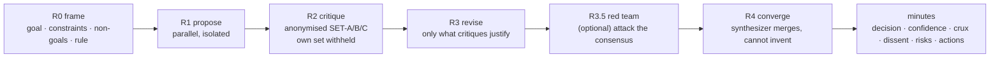

# ai-council

**A model-agnostic protocol for making several AIs disagree usefully.**

2–7 models from different labs work one question as a structured council:
**independent proposals → anonymised cross-examination → revision → convergence.**
You get a decision with a confidence score, the live disagreements and their
crux, the strongest minority view verbatim, and the cost of finding out.

Not a framework. No SDK, no vendor, no orchestration runtime — a `SKILL.md` plus
a single-file runner in the standard library. Any model that can answer one
prompt can take a seat.

`MIT` · `Python 3.10+` · `zero dependencies` · `30 offline tests` · `EN + 中文`

---

## Why the obvious version fails

Asking five models the same question and picking the popular answer fails in
four predictable ways. Every design decision in this repo exists to make one of
them harder:

| Failure | Mechanism | Countermeasure |
|---|---|---|
| **Anchoring** | the first answer seen frames every later one | R1 runs isolated and in parallel; nobody sees anybody |
| **Status bias** | the famous model gets deference | R2 inputs anonymised (`SET-A/B/C`), own set withheld |
| **Sycophancy** | models agree with the premise to be helpful | a dedicated critic; agreement without new evidence is an invalid critique |
| **Fake consensus** | the summariser sands a real split into mush | mandatory `crux` per contested item; dissent preserved verbatim; the synthesiser may not invent |

## 30-second demo — no keys, no network

```bash
git clone https://github.com/<you>/ai-council.git && cd ai-council
python scripts/council.py demo
```

Five seats, four rounds, all offline. It writes:

```
runs/demo-grpc-migration/transcript.md   # the "group chat", for humans
runs/demo-grpc-migration/minutes.md      # the decision record
runs/demo-grpc-migration/minutes.json    # structured, for machines
```

Excerpt (real output; the model replies are local mocks, to show the shape):

```markdown
## R1 propose · independent, mutually invisible
#### Generalist `generalist` · mock/mock-general
**stance** Build the dual stack and contract tests first, then decide.
- **C1 · inference · conf 0.62 · high** — Two phases: read-only shadow traffic, then writes.

## R2 cross-examination · anonymised
#### Critic `critic` · mock/mock-red
- **[HIGH]** `SET-A/C1` · logic — Jumps from baseline to benefit; the failure-rate
  assumption is missing.
  - fix: publish current vs expected failure rate before arguing benefit.

## Decision
> **Proceed conditionally: baseline first, shadow traffic second, writes only if the bar is met.**

## Dissent (verbatim, preserved)
> The consensus overestimates the benefit and underestimates the blast radius
> during the dual-stack period. — `critic`
```

That last section is the difference between this and "I asked a few AIs".

## Three ways in

| Mode | Needs | When |
|---|---|---|
| **A. Automated** — `scripts/council.py` | Python 3.10+, API keys | you have a shell; want reproducible minutes |
| **B. Relay** — `references/relay-kit.md` | just browser tabs | chat-only AIs, no keys, or you want to watch |
| **C. Solo** — one model, several roles | nothing | one window, still better than a single pass |

Every AI can join: in relay mode you are the message bus, and in automated mode
a new provider is six lines of config. The ready-to-paste relay pack (four seat
cards, task frame, three round prompts, a ledger — Chinese and English) is in
[`assets/group-chat-kit/`](assets/group-chat-kit/README.md).

## How a round works



Three non-negotiables: **R1 is isolated**, **R2 is anonymised and hides your own
set**, **the synthesiser may only merge, never invent**. Full rules:
[`references/protocol.md`](references/protocol.md).

## Start at the bottom of the ladder

| Level | Seats | Rounds | Calls | Use for |
|---|---|---|---|---|
| L0 solo | 1 model × 3 views | 2 | 2 | sanity check |
| L1 pair | producer + critic | 3 | 5 | **review — best value** |
| L2 triad | generalist + specialist + critic | 4 | 10 | design, planning |
| L3 council | 4–6 debating seats + synthesizer | 4 | 13–19 | irreversible decisions |
| L4 court | L3 + red team | 5 | 14–20 | money, safety, public commitments |

Escalate only when the level below reaches a real disagreement.

## Models

Any of these can take a seat; `python scripts/sync_models.py` tells you what your
keys actually serve today (model ids rot faster than READMEs):

GPT / o-series · Claude · Gemini · DeepSeek · Qwen · Kimi · GLM · Grok ·
Llama (Groq, Together, local) · Mistral · Ollama / vLLM / LM Studio · OpenRouter
(one key, many families).

The first rule of seating is not "pick the strongest model" — it is **pick the
critic from a different lab than the generalist**. Same-family models fail
together for the same reason. Selection, cost and calibration:
[`references/models.md`](references/models.md).

## Layout

```
SKILL.md                  # entry point every agent discovery layer reads
references/               # protocol, models, adapters, patterns, prompts, relay, publish
scripts/council.py        # orchestrator: rounds, providers, budget, minutes
scripts/sync_models.py    # live model-id survey per provider
examples/  assets/  tests/  .github/workflows/ci.yml
```

## FAQ

**How much does a run cost?** `seats × rounds` calls; latency is
`rounds × slowest seat` because a round runs in parallel. Cheapest useful shape:
cheap models in propose/revise, one strong model in the synthesiser. Run
`--dry-run` to see the exact count and which seats lack keys.

**Won't they just agree with each other?** They will if you ask naively — that
is the reason the protocol exists. Isolation, anonymisation, a critic with a
single job, a red team aimed at the emerging consensus, and a synthesiser
forbidden from inventing. None of it guarantees disagreement; all of it makes
agreement expensive to fake.

**Does this make answers correct?** No. It raises the probability of catching an
error. Consensus is not truth, and the preserved dissent is often the most
valuable page in the minutes. A human decides.

**Why not LangGraph / CrewAI / AutoGen?** Those are frameworks: you write code
that runs stateful agents. This is a protocol plus one script — any model, any
host, with or without code, output is a decision record rather than a running
system. They compose: call `council.py` as a node.

## Safety

- seats produce text only — they never execute, write, or fetch
- keys come from the environment; transcripts are redacted, but redaction is a
  safety net, not a guarantee
- do not paste confidential material into third-party chat UIs; a local Ollama
  seat is the private option
- `runs/` is gitignored — it holds your private questions

## 中文

完整中文说明见 [`README.zh-CN.md`](README.zh-CN.md)。

## License

MIT. Use it commercially, fork it, rename it.

> Consensus is not truth. Keep the dissent.
