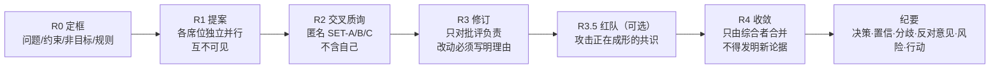

# AI Council · 把任何 AI 拉进同一个群聊

**一个模型无关的多 AI 协作协议。** 让 2–7 个来自不同厂商的模型就同一个问题
*先各自独立思考 → 匿名互评 → 修订 → 收敛*，最后给你一份带置信度、保留反对意见、
可追溯的决策纪要。

它不是框架，不绑定任何厂商：一个模型只要能回答一次提问，就能坐进一个席位。
纯标准库，零依赖。

`MIT` · `Python 3.10+` · `0 依赖` · `30 个测试` · `中英双语文档`

---

## 它解决什么

单模型的问题不是"不够聪明"，而是**只有一个视角，而且往往自信而浅**。

但"把同一个问题问 5 个模型，再看谁的答案多"同样不行，它会以四种可预测的方式失败：

| 失败机制 | 表现 | 本协议的解法 |
|---|---|---|
| **锚定** | 先看到的答案框住了后面所有模型 | 第一轮**隔离并行**，谁也没见过谁 |
| **地位偏见** | 名头大的模型说什么都对 | 第二轮输入**匿名化**为 `SET-A/B/C`，且不含自己 |
| **谄媚** | 模型顺着提问者的预设往下说 | 专门的红队席位；不带新证据的"同意"视为无效批评 |
| **假共识** | 汇总者把真实分歧磨成一句圆滑的话 | 每个争议必须写清 `crux`（决胜点），反对意见**原文保留** |

协议的全部设计，就是为了让这四件事很难发生。

---

## 30 秒看效果（不需要任何 API Key）

```bash
git clone https://github.com/<you>/ai-council.git
cd ai-council
python scripts/council.py demo
```

它会跑一场 5 席位、4 轮、全离线的示例议事，产出：

```
runs/demo-grpc-migration/transcript.md   # 群聊记录，人看
runs/demo-grpc-migration/minutes.md      # 决策纪要
runs/demo-grpc-migration/minutes.json    # 结构化数据，机器看
```

记录长这样（真实输出，模型回答是本地 mock，用来展示结构与流程）：

```markdown
## R1 提案 · 独立思考，互不可见
#### 通才 `generalist` · mock/mock-general · 0.0s
**立场** 先建双栈与契约测试，再决定是否继续
- **C1 · inference · 置信 0.62 · 高** — 从整体收益与可逆性看，分两阶段推进…
*待补信息*: 基线数据从哪来？

## R2 交叉质询 · 匿名编号
#### 红队 `critic` · mock/mock-red · 0.0s
- **[HIGH]** `SET-A/C1` · logic — 结论从基线跳到收益，缺少一层失败率假设。
  - 修法：先给出现有失败率与迁移后预期失败率，再谈收益。

## 结论
> **有条件推进：先补失败率基线，再做只读影子流量，够格才切写流量；否则维持现状。**
置信 0.62 · 规则 supermajority

## 少数意见（原文保留）
> 共识高估了收益、低估了双栈期的事故半径。 — `critic`
```

注意最后一节：**少数意见不会被删掉**。这是它和"让 AI 们聊一下"最大的区别。

---

## 三种接入方式

| 方式 | 需要什么 | 什么时候用 |
|---|---|---|
| **A. 自动编排** `scripts/council.py` | Python 3.10+、几个 API Key | 你有命令行和 Key，想要可复现的纪要 |
| **B. 接力模式** `references/relay-kit.md` | 只要几个网页标签页 | 只有网页版 AI、不想填 Key、或想全程盯着 |
| **C. 自我议事** | 什么都没有 | 只有一个聊天窗口，也比单次提问强 |

**"任何 AI 都能接入"是真的**：模式 B 里，你是消息总线，模型只要能回答一次提问就能入场；
现成的粘贴文本包在 [`assets/group-chat-kit/`](assets/group-chat-kit/README.md)，5 个网页版 AI 也扛得住。
模式 A 里，加一个厂商只需要在配置里写 6 行。

---

## 一轮是怎么跑的



三条不可妥协的规则：

1. **第一轮必须隔离。** 席位在这个阶段互相看不见，否则就不叫独立判断。
2. **互评必须匿名。** 去掉名字，去掉自己那一组，标签每轮重排。
3. **收敛者只能合并，不能发明。** 每句话都要能追到某个席位的某一轮。

完整规则见 [`references/protocol.md`](references/protocol.md)。

---

## 规模阶梯：别一上来就兴师动众

| 档位 | 席位 | 轮次 | 调用数 | 适合 |
|---|---|---|---|---|
| L0 独思 | 1 个模型 3 种视角 | 2 | 2 | 快速自查 |
| L1 双人 | 生产者 + 批评者 | 3 | 5 | **日常评审，性价比最高** |
| L2 三人 | 通才 + 专家 + 红队 | 4 | 10 | 方案设计 |
| L3 议会 | 4–6 个辩论席 + 综合者 | 4 | 13–19 | 不可逆的决策 |
| L4 法庭 | L3 + 红队 | 5 | 14–20 | 钱、安全、公开承诺 |

**先用低档；只有在低档出现真实分歧时才升级。** 大多数问题在 L1 就结束了。

---

## 支持哪些模型

不是"支持列表"，而是"只要你这么接"：

| 家族 | 示例（会随版本变化，用 `sync_models.py` 查真实 id） | 适合的席位 |
|---|---|---|
| OpenAI GPT / o 系列 | `gpt-5`、`gpt-5-mini` | 通才、执行者 |
| Anthropic Claude | `claude-opus-5-5`、`claude-sonnet-5` | 红队、专家 |
| Google Gemini | `gemini-3-pro`、`gemini-3-flash` | 专家、综合者 |
| DeepSeek | `deepseek-chat`、`deepseek-reasoner` | 专家、执行者 |
| 阿里 Qwen | `qwen3-max`、`qwen-flash` | 专家 |
| Moonshot Kimi | `kimi-k2`、`kimi-k3` | 通才、专家 |
| 智谱 GLM | `glm-5`、`glm-4.6` | 通才 |
| xAI Grok | `grok-4` | 红队 |
| Meta Llama | `llama-4-*`（Groq/Together/本地） | 执行者 |
| Mistral | `mistral-large` | 专家 |
| 本地 | Ollama / vLLM / LM Studio 里任何模型 | 红队、起草 |
| 聚合网关 | OpenRouter（一把 Key 通大多数家族） | 任意 |

**选模型的第一原则不是"哪个最强"，而是"红队和通才必须来自不同厂商"。**
同一家的模型会为同一个理由一起错，那是最贵的假共识。

详细选型、成本与调参见 [`references/models.md`](references/models.md)。

---

## 目录结构

```
ai-council/
├── SKILL.md                  # 入口：任何 Agent 的发现层读这个
├── README.md / README.zh-CN.md
├── references/
│   ├── protocol.md           # 协议全文：轮次、JSON、规则、停止条件
│   ├── models.md             # 选模型、选席位、成本
│   ├── adapters.md           # 各家 API 接线、本地模型、网关
│   ├── patterns.md           # 8 种协作拓扑，怎么选
│   ├── prompts.md            # 可直接复制的角色卡与轮次指令
│   ├── relay-kit.md          # 无 Key 的接力操作手册
│   └── publish.md            # 发 GitHub、装进各种 Agent
├── scripts/
│   ├── council.py            # 编排器（纯标准库，单文件）
│   └── sync_models.py        # 查各家当前真实可用的模型 id
├── examples/                 # 三份可直接改的配置
├── assets/                   # 配置模板、纪要模板
│   └── group-chat-kit/       # 5 个网页版 AI 的接力文本包（没有 API 就用这个）
├── tests/                    # 25 个离线测试
└── .github/workflows/ci.yml  # 3.10–3.13 矩阵
```

---

## 三个最常被问到的问题

**"需要多少钱？"**
按 `席位 × 轮次` 计费。省钱的办法是把便宜模型放在提案/修订席，只在综合席用一次强模型：
一个 flash 级别的三人组，总成本通常低于一次前沿模型的单次长回答。先跑
`--dry-run` 看准确的调用次数。

**"模型们会不会只是互相附和？"**
会——如果按直觉去问的话。这恰恰是本协议存在的理由：隔离第一轮、匿名第二
轮、强制"批评必须给出缺陷和修法"、红队专门攻击正在形成的共识、综合者被禁止
发明论据。机制不能保证它们一定分歧，但能让附和变得不划算。

**"能保证答案更对吗？"**
不能。它提高的是**发现错误的概率**，不是正确率上限。共识不是真相，纪要里保留
的反对意见往往比结论更有用。最终判断永远由人负责。

---

## 安全与边界

- 席位只会输出文本：**不会**执行代码、不会改文件、不会发请求。行动由人或由有权限的编排者执行
- Key 只从环境变量读取，transcript 与纪要会脱敏 `sk-…` 等模式；但**脱敏是兜底，不是保证**
- 不要把小范围私密数据贴进第三方网页版；本地 Ollama 席位是私密场景的解法
- 会话记录（`runs/`）可能包含敏感问题，仓库默认已 gitignore

---

## 和 LangGraph / AutoGen / CrewAI 有什么区别？

它们是**框架**：你写代码去编排有状态的 Agent 运行时。
这里是**协议 + 一个 400 行脚本**：任何模型、任何宿主、有没有代码都能跑，产物是
一份决策记录，而不是一个运行中的系统。两者可以叠加——把 `council.py` 当成
一个节点，或者让 Crew 采用同样的轮次结构。

需要长期在线的多 Agent 编排，用框架；需要几个模型就一个问题**有用分歧一次**，用这个。

---

## 许可

MIT。随便用，包括商用。如果它帮你想清楚了一个决定，欢迎回来提一个 issue 讲讲 case。

> 共识不等于正确。保留分歧，是人类和模型都该有的体面。
